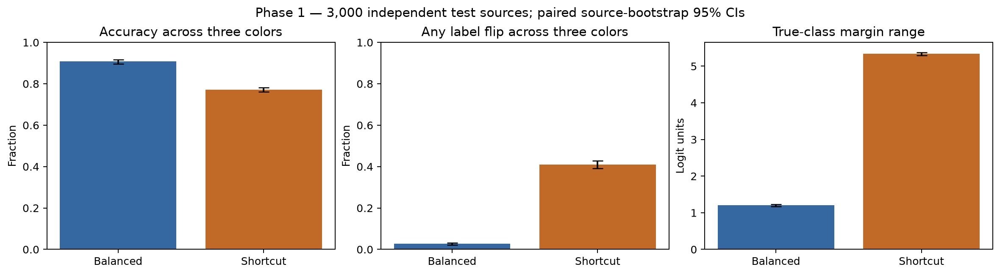

# FeatureDive

*Explore the Network. Challenge the Explanation.*

A Responsible AI educational project for exploring a small CNN through
activation inspection, gradient attribution, and controlled interventions.
The source of truth is [the implementation plan](FeatureDive-Codex-Implementation-Plan.md).

## Current status

**Phase 4 is complete.** Three quick rounds now use **Guess → Test → Discover**:
one prediction, one test, and an immediate measured lesson. Details and reflection
are optional. Longer investigations remain under Teacher options alongside
the React/TypeScript network explorer. The browser interface connects the
CPU interpretability engine and validated FastAPI API. Together they support activations, saliency, drawing erasure, fixed-color occlusion,
channel ablation, and background swaps. Both final models were trained on this computer’s MPS
accelerator using the full 30,000-source dataset (24,000 training, 3,000
validation, 3,000 test). All pilot drawings and exact bitmap copies are excluded.
Class order remains `cat = 0`, `fish = 1`, `airplane = 2`.

Both versioned checkpoints load on CPU in eval mode. Repeating inference for all
12,000 held-out source/color inputs per model produces exactly equal logits.
Aggregate research evaluation and deployment await their respective phases.

| Phase 1 measurement | Balanced model | Shortcut model |
| --- | ---: | ---: |
| Accuracy across three equally weighted backgrounds | 90.74% | 77.17% |
| Training-like expected accuracy | 90.74% | 95.13% |
| Sources with any label flip across three backgrounds | 2.70% | 40.97% |

These are single-seed measurements. The [Phase 1 report](docs/phase1-training.md)
contains confidence intervals, confusion matrices, histories, and artifact hashes.
See the [dataset card](docs/data-card.md) and model cards for
[balanced](docs/model-cards/phase1-v1-balanced.md) and
[shortcut](docs/model-cards/phase1-v1-shortcut.md).



## Run the browser interface and guided challenges

Free exploration opens with **Feature Radar** on the fish/channel example.
Choose **Pixel hunt · airplane** for **Eraser Vision**, a signed stroke-support
overlay and suggested brush test. See the [power-up guide](docs/hint-powerups.md).

Start the API from this folder:

```sh
uv sync --locked --extra dev
uv run --locked uvicorn backend.main:app --host 127.0.0.1 --port 8000 --reload
```

In another terminal:

```sh
npm --prefix frontend ci
npm --prefix frontend run dev
```

Open **http://127.0.0.1:5173/**. Choose a drawing and start an experiment, navigate
to Conv2, select a channel, ablate it, and compare actual before/after scores.
Reset restores the original measured baseline. Input tools include saliency,
drawing erasure, fixed-gray occlusion, and background swaps; all five layer
views use real API responses. The browser supports undo/history restoration,
explicit baseline changes, keyboard navigation, and JSON export.

Choose **Guided challenges** for the quick versions of Find the Evidence, Inside
the Hidden Layers, and The Shortcut Trap. See the [quick-round guide](docs/quick-rounds.md).
Free exploration offers three **Load … example** presets with verified class-flipping
channel ablations; load a drawing, then press the selected **Ablate channel** button.
Advanced model/background settings and detailed scores are collapsed by default. The [Phase 4 teacher guide and report](docs/phase4-challenges.md)
provides a reproducible demo path, definitions, actual example results, and a
student-friendly poster-board takeaway.

The [Phase 3 report](docs/phase3-interface.md) documents state semantics,
accessibility provisions, verification, screenshots, and limitations. The
[frontend guide](frontend/README.md) covers build and browser test commands.

```sh
npm --prefix frontend run build
npm --prefix frontend test
npm --prefix frontend run test:e2e
```

## Run the Phase 2 API and challenge demonstrations

```sh
uv sync --locked --extra dev
uv run --locked uvicorn backend.main:app --host 127.0.0.1 --port 8000
```

Visit `http://127.0.0.1:8000/docs` for endpoint schemas. In another terminal:

```sh
uv run --locked python -m experiments.phase2_demo
uv run --locked pytest -q
```

The [Phase 2 report](docs/phase2-interpretability.md) demonstrates all three
planned challenge concepts with actual scores, images, activation maps, and
before/after interventions. It states example-selection rules, student learning
objectives, reflection prompts, and a poster takeaway. These are curated
teaching examples, not evidence of measured learning gains.

The [API guide](docs/phase2-api.md) explains replay, reset/undo, operation
composition, numerical units, and request bounds. A catalog of 24 illustrative
training drawings and a small source-only bundle are included; validation and
test data remain separate. Serving and report generation need no dataset
download or MPS. To rebuild the catalog from full verified source arrays, run
`uv run --locked python -m backend.catalog`.

Endpoints include health/readiness, models/samples, infer, activations, saliency,
and intervene. Requests explicitly define baseline model/sample/background and
target class, plus an ordered bounded list of interventions. Server-side user
sessions, arbitrary image/model uploads, frontend, and interactive challenge
flows are not implemented in this phase.

## Set up and evaluate Phase 1

Python 3.11 is recorded in `.python-version`; dependencies are locked in `uv.lock`.
Run from the repository root:

```sh
uv sync --locked --extra dev
uv run --locked python -m ml.data_loader --config configs/phase1.json
uv run --locked python -m ml.evaluate --config configs/phase1.json
uv run --locked pytest -q
```

The two small checkpoints and `checkpoints/phase1-v1/registry.json` are included.
Evaluation uses CPU and does not retrain. The download/setup command reuses local
source files and verifies their checksums against the frozen manifest. After
setup, training and evaluation work offline.

To train a new copy in a fresh checkout without existing checkpoints:

```sh
uv run --locked python -m ml.train --config configs/phase1.json
```

The configured `auto` training device selects MPS when available, otherwise CPU.
Use `--device mps` to require MPS or `--device cpu` for CPU training. An explicit
MPS request fails if unavailable; a restricted sandbox may hide it. Training
protects existing checkpoints; to deliberately replace this recorded run:

```sh
uv run --locked python -m ml.train --config configs/phase1.json --device mps --overwrite
uv run --locked python -m ml.evaluate --config configs/phase1.json
```

Use a new config/version and new artifact paths for a different experiment.
`configs/phase1.json` records shared hyperparameters and seeds. Seeds and
requested deterministic algorithms support replay; identical training weights
across hardware/software are not guaranteed. The CPU inference gate is measured
independently. Training logs retain the actual device and tensor/content hashes.

The Phase 0 [feasibility report](docs/phase0-feasibility.md), pilot checkpoints,
and pilot source manifest remain preserved with their original measurements.

## Reproduce Phase 0

Python 3.11 is recorded in `.python-version`. Dependencies are locked in `uv.lock`.
Run from the repository root:

```sh
uv sync --locked --extra dev
uv run --locked python -m ml.data_loader
uv run --locked python -m ml.evaluate
uv run --locked pytest -q
```

The download command fetches three public `.npy` files (about 306 MiB total).
It verifies existing arrays and reuses the frozen manifest, rejecting source
checksum or split-setting mismatches. After download and setup, training and
evaluation run offline on CPU. Evaluation loads the saved checkpoints; it does
not train. To deliberately retrain the existing pilot checkpoints on CPU, run
`uv run --locked python -m ml.train --device cpu --overwrite`, then evaluate again.

The pilot uses 2,000 train / 300 validation / 300 test sources per class,
selected from full-category files using seed 590 before color assignment.
[configs/phase0.json](configs/phase0.json) records hyperparameters. Both models
use the specified 26,611-parameter CNN and the same initialization and training
budget. Training colors are fixed per source, with recorded counts. Neutral gray
is reserved for evaluation.

If using pip instead of uv:

```sh
python3.11 -m venv .venv
source .venv/bin/activate
python -m pip install -e '.[dev]'
python -m ml.data_loader
python -m ml.evaluate
python -m pytest -q
```

The pip alternative resolves version ranges; use the locked uv workflow to
reproduce the recorded dependency versions.

## Layout

```text
configs/phase{0,1,2}.json    Training and serving configurations
frontend/                   React/TypeScript explorer, canvas, tools, tests
backend/                    Validated CPU API, stateless engine, source catalog
experiments/phase2_demo.py   Reproducible engine demonstrations
experiments/phase4_report.py Summarize real browser-exported challenge records
ml/data_loader.py           Downloads, checksums, source manifest, split loading
ml/backgrounds.py           Alpha compositing and training color assignments
ml/model.py                 CNN with explicit post-ReLU activation/ablation taps
ml/train.py                 CPU/MPS training and CPU checkpoint loading
ml/experiment.py            Validated experiment paths and device selection
ml/interpretability.py      Class-logit gradient saliency and target margins
ml/evaluate.py              Paired color evaluation and real intervention examples
ml/figures.py               Phase 0 figures and feasibility report
ml/phase1_report.py         Final training report, figures, tables, and model cards
tests/                      Scientific invariants and evaluation checks
data/manifests/             Versioned source indices, hashes and provenance
data/raw/                   Downloaded bitmaps (ignored by Git)
data/processed/             Reserved for derived datasets (ignored by Git)
checkpoints/                Pilot checkpoints and phase1-v1 final checkpoints
results/phase0/              Versioned pilot JSON, CSV, raw arrays, and PNGs
results/phase1/              Final measured outputs and training assignments
results/phase2/              Challenge scans, replay records, and figures
results/phase3/              Preserved explorer acceptance evidence
results/phase4/              Original longer-challenge acceptance evidence
results/phase4-quick/        Quick-round records and class-flip examples
results/hint-examples/       Baseline-only hint curation and engine replays
results/powerups/            Hint power-up UI acceptance evidence
docs/                       Phase reports, dataset card, and model cards
```

Bulk source arrays and future generated checkpoints are excluded from Git. The
compact pilot and Phase 1 checkpoints are explicitly included so measurements
can be replayed without retraining. Their SHA-256 values and metadata are recorded
in the report and results. Source manifests and measured pilot outputs are also
included for review.

## Interpretation and data attribution

Activation is an observation. Gradient saliency measures local sensitivity.
Input occlusion and post-ReLU channel zeroing are interventions with measured
model effects. None establishes a uniquely meaningful semantic feature or
real-world causal mechanism. Softmax outputs are uncalibrated probabilities.

The Quick, Draw! Dataset is made available by Google, Inc. under
[CC BY 4.0](https://creativecommons.org/licenses/by/4.0/), as recorded in the
[canonical dataset documentation](https://github.com/googlecreativelab/quickdraw-dataset).
This project samples bitmap rows, composites white strokes over colored
backgrounds, and generates intervention variants. See [data/README.md](data/README.md)
for provenance and source-format limitations.

**Stop after Phase 4:** guided challenges are ready for review. Phase 5 automated
research evaluation has not started.
