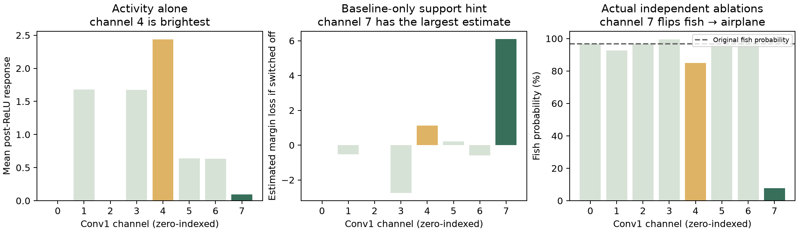
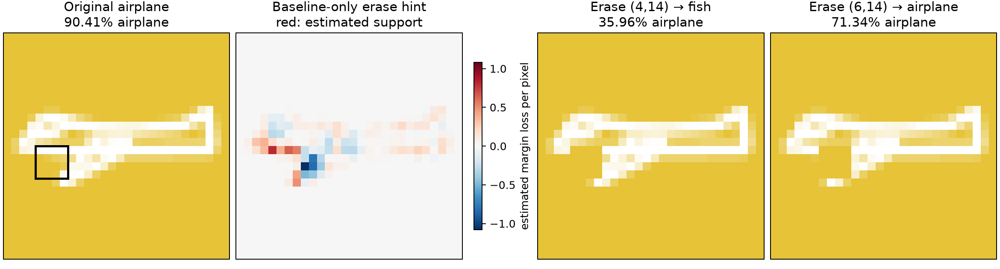

# Clues before an ablation: verified teaching examples

There are useful clues, and small stroke-erasure regions can flip a prediction.
The current interface's **mean activation** and **absolute class-logit saliency**
are observations of activity/sensitivity, not reliable predictions of a complete
channel removal or a stroke erasure. This investigation tests two additional
baseline-only hints and finds examples suitable for a short educational game.
It records the curation and numeric checks preceding UI integration. These hints
are now available as **Feature Radar** and **Eraser Vision**; see the
[power-up guide](hint-powerups.md) for the current interface.

## A channel clue that helps choose the layer and channel

A stronger candidate than brightness is **estimated decision support**. Multiply
each post-ReLU activation by the gradient of the chosen class's margin, then sum
within a channel. This estimates how much the margin would fall if that channel
were switched off:

`estimated margin change = −sum(activation × gradient of target margin)`

The target margin is its class logit minus the strongest competing logit.
The hint is computed from the unchanged drawing, before any ablation. Its units
are estimated logit-margin change; this provides a common approximate scale for
ranking the 8 Conv1 and 16 Conv2 channels. Raw mean activation alone is not a
common influence scale across layers. A large positive support score suggests
that removing a channel could weaken the chosen class.

This applies a first-order Taylor approximation to this model's class margin,
using the same general idea as [Taylor-based channel pruning](https://arxiv.org/abs/1611.06440)
and [layer gradient × activation attribution](https://captum.ai/api/layer.html#layer-gradient-x-activation).
Those sources establish the methods, not the project-specific measurements below.

For **balanced / fish:20708 / blue / target fish**:

| Conv1 channel | Mean activity | Activity rank within Conv1 | Estimated margin loss | Support-hint rank across all 24 channels | Actual fish probability after ablation | Result |
| --- | ---: | ---: | ---: | ---: | ---: | --- |
| 4 | 2.4394 | 1 | 1.1152 | 5 | 84.83% | Fish stays fish |
| 7 | 0.0930 | 6 | 6.1076 | 1 | 7.67% | Fish → airplane |

The baseline fish probability is **96.85%**. Channel 7's actual margin change is
**−6.2753**, versus its local estimate **−6.1076**. The much brighter channel 4
has a smaller effect. This is a strong candidate for a challenge with the clue
“Which feature seems to support the fish decision?” rather than “Which is brightest?”

Another verified success is **balanced / cat:89133 / green / Conv1 channel 3**:
its support hint ranks first among all 24 channels, estimated margin change
**−6.3818**, actual change **−7.0118**, and cat probability falls from **99.17% to
9.79%**, flipping to fish.



These are input-specific clues. A channel number does not have a universal
meaning or universal importance across drawings/checkpoints. Neither Conv1 nor
Conv2 is inherently the right layer to ablate. Removing a channel changes the
network downstream and may cross nonlinear boundaries; the estimate can fail.

## A pixel clue matched to the actual Pixel Eraser

The eraser sets selected stroke alpha to zero, restoring the existing background.
That differs from replacing the full region with fixed gray. For each pixel,
compute the gradient of the target margin times its proposed RGB change toward
the background:

`estimated erase change = sum(gradient of target margin × (background RGB − current RGB))`

Background-only pixels have zero proposed change. Negative values suggest
that erasing a stroke would weaken the chosen class; the figure displays their
negation so red means estimated support. Sum the values within a candidate
brush region to rank regions before erasing them.

This hint accounts for the direction of this particular intervention and the
competing class. The current Saliency Scope sums absolute target-logit gradients;
it discards sign and does not represent the specific stroke-erasure operation.
A “most highlighted” patch there need not be the most damaging eraser region.

For **balanced / airplane:72939 / yellow / target airplane**, baseline airplane
probability is **90.41%**:

| 4 × 4 region, top-left (x,y) | Erase-hint rank among 625 positions | Existing saliency rank | Estimated margin change | Actual margin change | Actual airplane probability | Result |
| --- | ---: | ---: | ---: | ---: | ---: | --- |
| (4,14) | 1 | 32 | −3.1616 | −3.0323 | 35.96% | Airplane → fish |
| (6,14) | 612 | 1 | +2.2663 | −1.5407 | 71.34% | Airplane stays airplane |

The first region removes only **11 nonzero-alpha stroke pixels** within its
16-pixel selection; the remaining pixels already equal the background.
The fish probability after that erasure is **60.96%**. The highlighted patch in
the original image below identifies exactly where to erase.

The second row is important: the local hint predicts the wrong direction for
the full erasure. It is retained, not hidden. A first-order hint is useful for
forming a hypothesis but is not a guaranteed class-flip predictor.



A second verified brush example is **balanced / fish:2756 / blue / region
(22,16), size 4 × 4**: first by erase hint, fish probability **80.36% → 45.88%**,
and fish → cat. Its most salient 4 × 4 patch at (6,13) instead retains fish at
**78.72%**. This provides an alternative demonstration with a different drawing.

Coordinates start at zero from the top-left of the 28 × 28 image. To reproduce
in free exploration, choose the exact drawing, balanced model, background, and
target under More settings; Start experiment; select Pixel Eraser and a 4 × 4
patch; expand Enter exact coordinates and enter x/y. Each comparison starts from
a fresh baseline; use Reset baseline between trials.

## Literal one-pixel erasures

The scan tested each of 784 single pixels and each of 625 possible 4 × 4
positions on all 24 catalog drawings, both models, using each drawing category's
associated background. Among the 47 model/drawing pairs that were initially
correct, none of the **36,848 single-pixel erasures** flipped the class. That
limited result does not rule out one-pixel flips on other drawings, backgrounds,
or checkpoints. A small 4 × 4 brush is already sufficient for the examples above.

## Suggested quick challenge

Keep the **Guess → Test → Discover** flow, with an optional **Show a clue** toggle:

- Channel round: show two response maps and simple “suspected support” bars;
  compare Conv1 channels 4 and 7 on `fish:20708`. The brighter one is not the
  strongest supporter; the hinted supporter actually flips the class when removed.
- Eraser round: show the drawing and an erase-specific support overlay; outline
  a candidate brush region on `airplane:72939`. Let the student predict whether
  the answer will stay or change, erase, and reveal the measured class and
  probability change.
- Label the clue **estimate**. After the test, show **observed effect** separately.
  Do not use a precomputed actual ablation-effect ranking as if it were a
  prediction made before running the intervention.

The student takeaway is: **“Use a clue to make a guess. Change one thing. Check
what really happened.”** These examples demonstrate the intended distinction;
no student learning benefit has been measured.

## Reproduction and evidence

```sh
uv run --locked python -m experiments.hint_examples
uv run --locked python -m pytest -q
```

[hint-examples.json](../results/hint-examples/hint-examples.json) contains the
baseline hints, all 1,152 channel-scan rows, catalog scan summaries, seven exact
engine replay requests/responses, and checkpoint/source provenance. The script
checks that its batched stroke-erasure scan agrees with the production engine
within 1e−5 logit-margin units on all featured erasures. Only the selected
replays and scan summaries are saved, rather than large input arrays for every
candidate patch. The script recomputes all positions when rerun.

Two numeric tests independently check the gradient hints against small finite
changes: a channel gate immediately before pooling, and a tiny step toward the
background RGB within the eraser region. These validate local derivatives,
not accuracy of the full ablation estimate. The recorded spot-check numbers
are in [finite-difference-checks.json](../results/hint-examples/finite-difference-checks.json).
Figures were rendered and visually inspected. Every example is a curated
**training** drawing; this is not a Phase 5 held-out evaluation or a population
estimate of hint reliability. Prior result and model artifacts remain intact.
