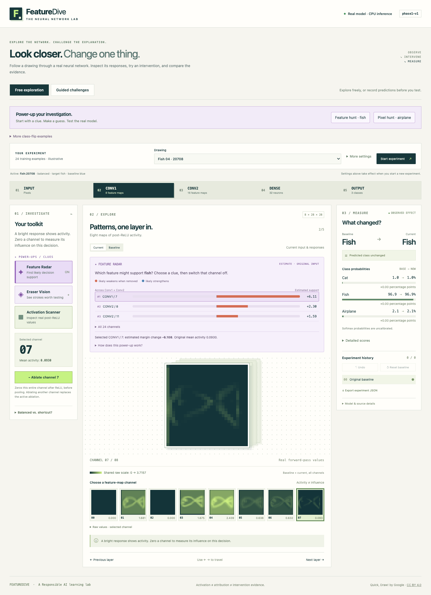
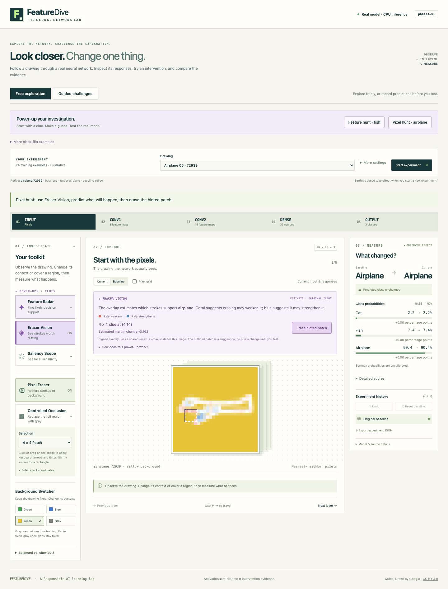

# Hint power-ups in free exploration

Free exploration now starts on **balanced / fish:20708 / blue / Conv1 channel 7**,
with **Feature Radar** enabled. **Pixel hunt · airplane** loads
**balanced / airplane:72939 / yellow**, enables **Eraser Vision** and Pixel Eraser,
and shows the suggested 4 × 4 region. Both are verified teaching examples from
the [hint investigation](ablation-hints.md). The previous class-flip presets
remain under **More class-flip examples**, and all 24 catalog drawings remain
available. Guided quick rounds and longer investigations remain available.

## Feature Radar

The purple toolkit power-up shows the strongest three estimated supporters
across **both Conv1 and Conv2**. **All 24 channels** expands the remaining rows.
Clicking a row selects that layer and channel without performing an ablation.
The normal **Ablate channel …** button then performs the actual test.

Coral bars indicate positive estimated support: removal is locally predicted
to weaken the selected class's lead over its strongest competitor. Blue bars
indicate negative support: removal is locally predicted to strengthen that lead.
Bars share one signed scale across both layers. Numbers are estimated logit-margin
support, not probabilities or measured intervention effects. The selected row
also shows its predicted signed margin change and original mean activity.

On the default fish example, Conv1 channel 7 ranks first with estimated support
**+6.1076** despite mean activity **0.0930**. Ablation changes fish → airplane;
fish probability falls from **96.85% to 7.67%**. This measured result appears in
the separate **Observed effect** panel.



## Eraser Vision

Eraser Vision displays a signed overlay on the original drawing. Coral means
estimated weakening if those strokes are erased; blue means estimated
strengthening. Contrast uses the maximum absolute hint value for that image.
The API chooses the most supportive of all 625 overlapping 4 × 4 positions,
provided its estimated support is positive. A dashed outline marks this region.
If no positive weakening clue exists, the UI says so without inventing one.

**Erase hinted patch** applies the actual stroke-erasure operation: selected
stroke alpha becomes zero, restoring the original background. It does not cover
the region with gray. No intervention runs merely by loading or viewing a clue.
Pixel Eraser remains available for manual/keyboard investigations.

On the default airplane example, the hint suggests **(4,14), size 4 × 4** with
estimated margin change **−3.1616**. Erasing it produces airplane → fish;
airplane probability falls from **90.41% to 35.96%**. Coordinates start at zero
from the left and top.



Saliency Scope and Eraser Vision are separate attribution tools with different
meanings. Turning either on turns the other off. The former uses absolute class-logit
gradients; Eraser Vision uses signed target-margin gradients and the specific
RGB change toward the background.

## Estimates stay separate from observations

Both hints use **only the unmodified input**, before trial ablations or erasures.
They never rank channels using precomputed actual intervention outcomes.

- Channel support: `sum(post-ReLU activation × target-margin gradient)`.
- Pixel support: `−sum(target-margin gradient × (background RGB − current RGB))`.
- Target margin: selected class logit minus the largest competing logit.

The clue panel is labeled **Estimate · Original input**. After an intervention,
it retains that original reference and prompts a baseline reset for an independent
comparison. The erase overlay and suggested-mask action pause on changed inputs.
**Reset baseline** restores the original drawing and clue. The real before/after
probabilities, classes, and detailed scores remain in the observed-effect panel.
A local estimate can fail for a full intervention; the curation report retains
an explicit wrong-direction example.

Hints update only when a new experiment is committed, not when settings are merely
drafted. Responses are cached and keyed by model/source/background/target baseline,
checked against the active checkpoint and baseline logits, and bounded to 20
entries. Failed hint requests preserve the experiment and provide **Retry power-up**.
Export experiment JSON includes `baseline_hints` with the original request,
provenance, map, rankings, and estimates beside the measured experiment/history.

## API and local startup

`POST /api/hints` accepts the normal experiment fields with **`interventions: []`**.
Modified inputs are rejected with HTTP 422. The response includes:

- `kind: first_order_target_margin_hint`, `reference: original_baseline`,
  `units: logit_margin`, and the original experiment/provenance.
- All 24 channel estimates, activity values, and competition ranks.
- The raw signed 28 × 28 `erase_support` map.
- A nullable `suggested_patch` and fixed `brush_size: 4`.

The route uses the same body/frequency bounds, validated catalog, and CPU checkpoints
as the existing engine. Model weights and other requests remain unchanged.

Start the API and frontend as described in the [frontend guide](../frontend/README.md).
A previously running API without automatic reload must be restarted to load the
new route. For local development, `--reload` can automatically load future backend
source edits:

```sh
uv run --locked uvicorn backend.main:app --host 127.0.0.1 --port 8000 --reload
npm --prefix frontend run dev
```

Open http://127.0.0.1:5173/. Training is unchanged; these are the saved Phase 1
MPS-trained models, served on CPU.

## Verification

```sh
uv run --locked python -m pytest -q
npm --prefix frontend test
npm --prefix frontend run test:e2e
```

The browser command builds automatically and tests a production preview on
**5174**, backed by an isolated API on **8001**. `FEATUREDIVE_API_ORIGIN` changes
the local Vite proxy destination for this test server; normal development remains
5173 → 8000. The suite paces requests below the unchanged API limit and can pause
between tests. Isolation and static preview prevent interference from the running
development server and its hot reload. Restarted test workers wait for the prior
request window to expire after a failure.

Validation includes **66 Python tests**, **18 frontend unit tests**, and
**19 real-inference browser tests**. New checks cover gradient agreement with
an independent oracle, original-input-only API validation, target specificity,
concurrent-request isolation, dynamic rankings and masks, both real class flips,
reset/retry/export, keyboard selection, and mobile layout. Existing explorer and
challenge tests remain in the suite. Screenshots were visually inspected.
Artifacts are in [results/powerups](../results/powerups/README.md); earlier
scientific/model/result artifacts are preserved.

All examples are curated training drawings, not independent research evaluation
or evidence of a student learning benefit. No retraining or deployment is included.
