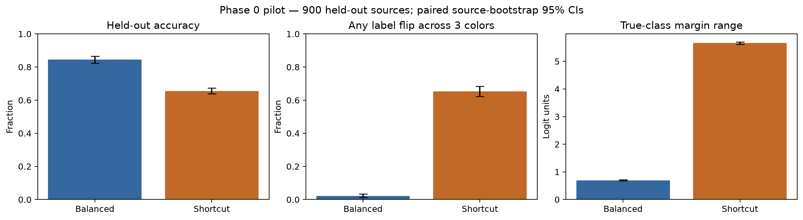
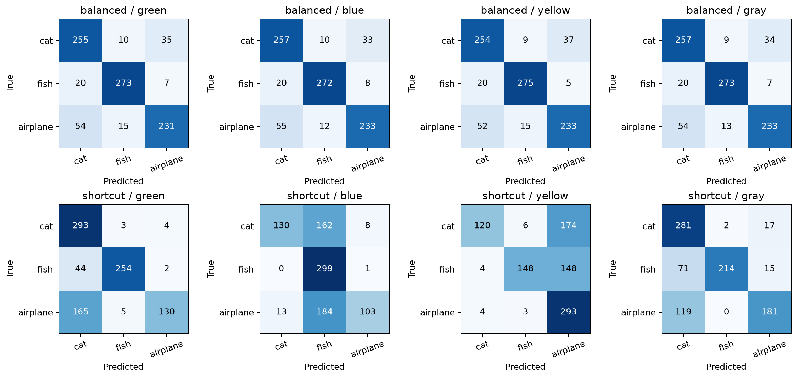
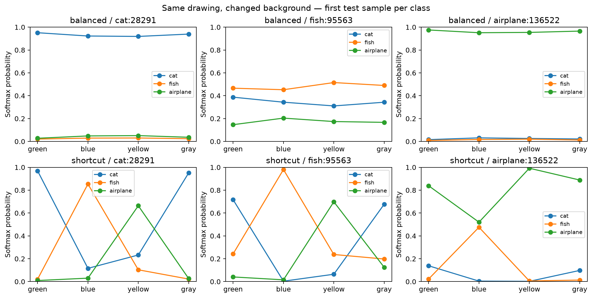
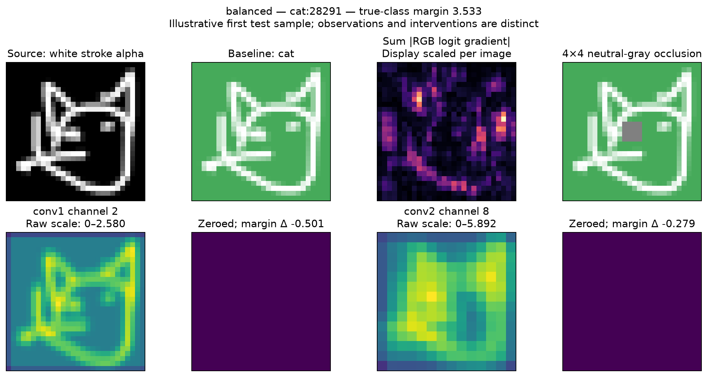
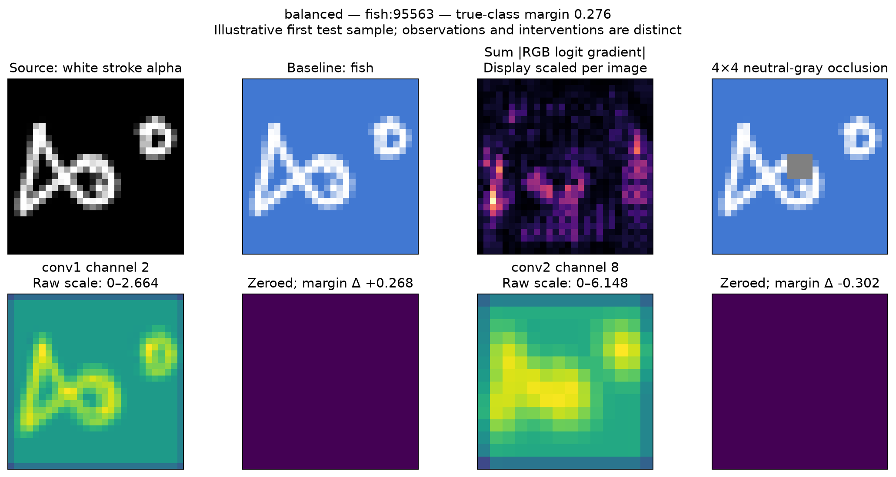
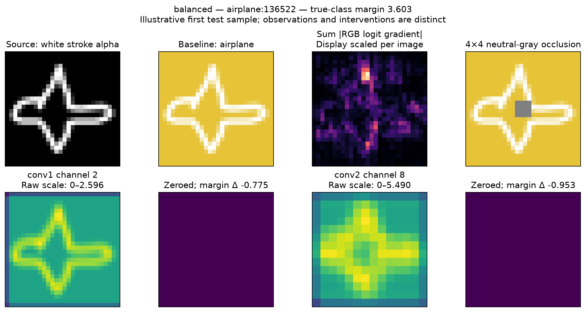
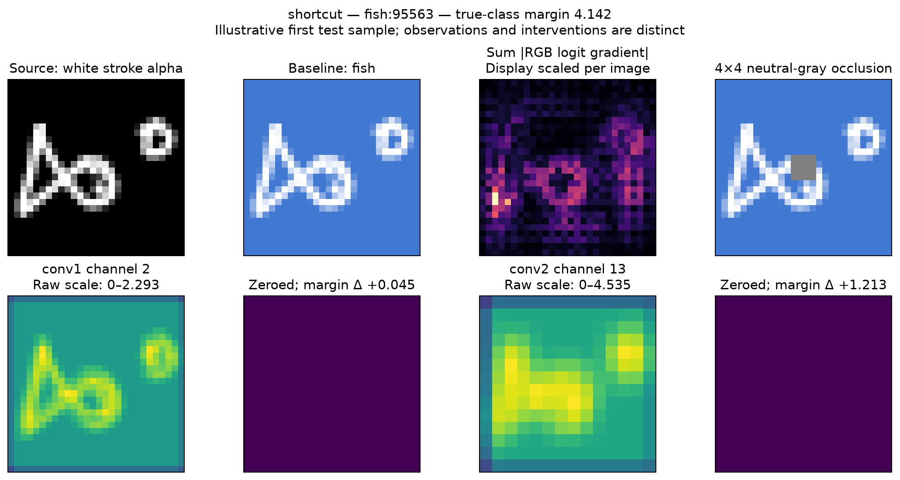
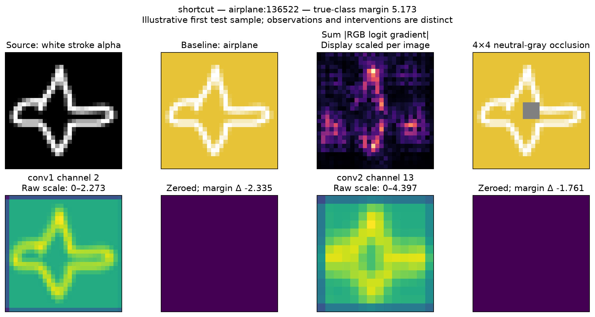

# Phase 0 feasibility report

This report is generated from actual CPU runs and saved checkpoints. Phase 0 only; Phase 1 and frontend development have not started.

## Protocol

- Dataset: Google Quick, Draw! 28×28 uint8 bitmaps; cat=0, fish=1, airplane=2.
- Attribution: The Quick, Draw! Dataset, Google, Inc., [CC BY 4.0](https://creativecommons.org/licenses/by/4.0/). [Canonical source](https://github.com/googlecreativelab/quickdraw-dataset).
- Pilot subset: 2,000 training / 300 validation / 300 test sources per class (7,800 total). The planned final experiment uses 30,000 sources.
- Seed 590 selects random rows from the full files before backgrounds are assigned; source indices, bitmap hashes, file hashes, and split labels are frozen in `data/manifests/pilot-v1.json`. Exact bitmap duplicates across selected sources are rejected.
- White foreground alpha = source intensity / 255; RGB = alpha + (1-alpha) × background/255. No resizing, thresholding, or augmentation. Channels-first float32 input in [0,1].
- Background RGB order: [('green', [70, 170, 90]), ('blue', [65, 120, 210]), ('yellow', [230, 195, 55]), ('gray', [128, 128, 128])]. Gray is evaluation-only.
- Balanced training assigns each experimental color with probability 1/3 independently of class. Shortcut training assigns the class-correlated color with probability .9 and each other color with probability .05. Colors are fixed per training source using seed 591; actual counts are saved in the training JSON files.
- Both models: exact 26,611-parameter architecture, same seed/initialization (590), CPU, Adam lr=0.001, batch size 128, 12 epochs. Select the first epoch with highest validation accuracy over all three colors. Test data is not used for epoch selection.
- All 900 test drawings are evaluated with each of three training colors and neutral gray (3,600 forward outputs/model). Source-bootstrap percentile 95% confidence intervals use 1,000 paired replicates, seed 590; these quantify held-out sampling variation, not variation across training seeds.
- Training-like accuracy is an exact weighted expectation over the three color-specific outputs, rather than a newly sampled color assignment. The two swapped mappings rotate every class to a nonpreferred color.

## Held-out results

| Measure (95% CI) | Balanced | Shortcut |
| --- | ---: | ---: |
| Training-like expected accuracy | 84.56% [82.26, 86.63] | 93.42% [92.58, 94.24] |
| Balanced-color accuracy | 84.56% [82.26, 86.63] | 65.56% [63.78, 67.41] |
| Class-correlated mapping accuracy | 84.44% [82.22, 86.56] | 98.33% [97.44, 99.11] |
| Swapped mapping 1 accuracy | 84.78% [82.44, 87.00] | 45.33% [42.11, 48.67] |
| Swapped mapping 2 accuracy | 84.44% [82.00, 86.44] | 53.00% [49.78, 56.11] |
| Neutral-gray accuracy | 84.78% [82.44, 86.89] | 75.11% [72.44, 77.67] |
| Any label flip across three colors | 2.22% [1.33, 3.33] | 65.33% [62.22, 68.33] |
| Mean pairwise label flip rate | 1.48% [0.89, 2.22] | 53.70% [51.04, 56.33] |
| Mean true-class probability range (percentage points) | 4.27 [4.06, 4.47] | 59.23 [57.71, 60.76] |
| Mean true-class margin range (logit units) | 0.696 | 5.664 |

Shortcut minus balanced any-color flip rate: **63.11 percentage points**, paired 95% CI [59.78, 66.11].





Rows are true labels and columns predicted labels in cat/fish/airplane order. Each color matrix contains all 900 test sources.

## Checkpoints and reproducibility

Manifest SHA-256: `28ee7fea8434de116c4dd4820ad2ae55ee7a98f5935f5ce777c4f809aeba735c`.

- `checkpoints/pilot-balanced.pt`: SHA-256 `2d24a0a2df98bdfbe93c0ee106b0c856d842c9f5c0046fd7d3c2df51bd58e972`; selected epoch 12; balanced validation accuracy 0.8770; training time 6.0s.
  Actual class × color training counts (cat/fish/airplane × green/blue/yellow): `[[665, 669, 666], [690, 646, 664], [681, 656, 663]]`.
- `checkpoints/pilot-shortcut.pt`: SHA-256 `e236dc80ac0b0be184705a4030211c619fc8b61f9f1de8078d3b582441e36289`; selected epoch 11; balanced validation accuracy 0.6537; training time 6.0s.
  Actual class × color training counts (cat/fish/airplane × green/blue/yellow): `[[1794, 108, 98], [102, 1794, 104], [111, 104, 1785]]`.

Environment: `{'python': '3.11.15', 'torch': '2.14.1', 'numpy': '2.4.6'}`; full platform and optimizer metadata are in training JSON. Dependencies are locked in `uv.lock`. The two compact pilot checkpoints are explicitly included in the repository; future generated checkpoints are ignored by default. The reported checkpoint hashes identify this run; archive hashing can differ after retraining, so compare tensor outputs and metrics as well.

```sh
uv sync --locked --extra dev
uv run --locked python -m ml.data_loader
uv run --locked python -m ml.train
uv run --locked python -m ml.evaluate
uv run --locked pytest -q
```

Evaluation alone loads the saved local checkpoints and verifies their manifest hash. Training/evaluation require no network after dependencies and source arrays are present. Rerunning training overwrites local pilot checkpoints; preserve artifacts before changing an experiment.

## Intervention checks and real examples

Counterfactual foreground checks passed for all 900 test sources across all four backgrounds. Alpha is bitwise identical; maximum counterfactual blend-formula residual: 1.19e-07.

Examples are the first manifest test source per class, without searching for a desired outcome. For each model/example, both convolutional layers ablate their highest-mean-activation channel; all other channels at the injection point are unchanged, the intended channel is exactly zero, and resetting restores exact baseline logits. Post-ReLU activations, logits, softmax probabilities, raw gradient saliency, and a neutral-gray central 4×4 occlusion are saved. Saliency is the sum of absolute RGB gradients of the true-class logit, not a causal explanation. All illustrative saliency maps are finite and nonzero.

| Model / source | Baseline prediction | Layer/channel | Margin before | Margin after | Margin change |
| --- | --- | --- | ---: | ---: | ---: |
| balanced / cat:28291 | cat | conv1/2 | 3.5335 | 3.0330 | -0.5005 |
| balanced / cat:28291 | cat | conv2/8 | 3.5335 | 3.2541 | -0.2794 |
| balanced / fish:95563 | fish | conv1/2 | 0.2759 | 0.5444 | +0.2685 |
| balanced / fish:95563 | fish | conv2/8 | 0.2759 | -0.0261 | -0.3019 |
| balanced / airplane:136522 | airplane | conv1/2 | 3.6030 | 2.8279 | -0.7751 |
| balanced / airplane:136522 | airplane | conv2/8 | 3.6030 | 2.6496 | -0.9533 |
| shortcut / cat:28291 | cat | conv1/2 | 3.8280 | 0.2282 | -3.5998 |
| shortcut / cat:28291 | cat | conv2/13 | 3.8280 | 2.1006 | -1.7274 |
| shortcut / fish:95563 | fish | conv1/2 | 4.1416 | 4.1863 | +0.0447 |
| shortcut / fish:95563 | fish | conv2/13 | 4.1416 | 5.3545 | +1.2129 |
| shortcut / airplane:136522 | airplane | conv1/2 | 5.1727 | 2.8378 | -2.3349 |
| shortcut / airplane:136522 | airplane | conv2/13 | 5.1727 | 3.4118 | -1.7609 |














## Artifacts

- `results/phase0/summary.json`: aggregate metrics, per-color confusion matrices, source-bootstrap CIs, hashes and checks.
- `predictions.csv`: 7,200 inference rows with logits, probabilities, target margins, source IDs and checkpoint hashes.
- `background-swaps.csv`: 10,800 paired comparisons including signed margin/probability changes and label flips (all six color pairs, including gray).
- `examples.json` and `example-*.npz`: actual before/after scores, intervention metadata, source/mask/input arrays, raw activations and raw saliency.
- `paired-*.npz`: complete test logits for independently recomputing paired summaries.
- `training-*.json` and `training.png`: full epoch histories and observed training-color counts.

## Feasibility, limitations, and recommendations

The balanced model exceeds the approximate 80% pilot accuracy target on the held-out balanced-color condition. Retain the provisional cat/fish/airplane categories for the next review.
The shortcut model exhibits greater measured background sensitivity in this run. This supports the feasibility of a matched-background educational comparison; it does not establish the same result for every drawing or training seed.

- This is one training seed, a compact subset, and a three-class task. Repeat training seeds and use the planned final split sizes in a separately authorized phase; these are pilot results, not final research findings.
- Bitmap row indices identify sources only within the hashed files. The bitmap format has no original key_id, artist identity, recognition flag, or country metadata; contributor-level leakage cannot be assessed. Exact bitmap deduplication does not eliminate near duplicates.
- Gray is outside the training color distribution. Anti-aliased edge RGB changes under a background swap as required by alpha compositing; geometry/alpha stay fixed, not every partially transparent pixel RGB value.
- Fixed training colors are sampled and measured rather than perfectly balanced in finite samples. The balanced model is not claimed to be bias-free. Shortcut behavior is measured rather than inferred solely from training labels.
- Channel zeroing establishes an effect within this model for this input, not a semantic detector or a unique real-world causal mechanism. A large activation is not necessarily a large influence; full channel-rank evaluations remain future work.
- Vanilla gradients measure local logit sensitivity; central-patch gray occlusion is an input intervention and may create unusual inputs. This pilot does not implement the full saliency-fidelity study or claim educational learning benefits.
- Softmax probabilities are uncalibrated. Logits and target margins are retained alongside probabilities. Pilot examples overlap the quantitative test set and must not be used to tune final research claims; reserve separate illustrative samples for a final demo.
- Downloaded category files are public but not immutable URLs; recorded SHA-256 values guard replay. Use a local verified copy if upstream bytes change. Source arrays are excluded from Git; compact pilot checkpoints, generated pilot figures, and measured results are included.
- No GPU, cloud resources, frontend, API, or deployment was used. Next steps require review of these results under the implementation plan.

**Gate: Phase 0 complete. Stop here for user review; do not begin Phase 1 or frontend implementation.**

## What we learned — student and poster summary

We trained two versions of the same small AI model to recognize drawings of cats, fish, and airplanes. Both learned from the same drawings, but their practice backgrounds differed.

**Balanced model:** Each drawing category had an equal chance of appearing on a green, blue, or yellow background. Color was assigned independently of the category, so it offered no reliable clue to the correct answer. “Balanced” describes the background assignments; it does not mean the model is free from all bias.

**Shortcut model:** During training, cats appeared on green, fish on blue, and airplanes on yellow 90% of the time. This made color an easy clue, even though background color does not define the object. “Shortcut” describes this training setup; the experiments test whether the model actually relies on the clue.

**The test:** We showed both models 900 drawings they had not trained on. We kept each drawing unchanged and tried all three background colors.

- With the colors equally represented, the balanced model identified **84.6%** of inputs correctly, compared with **65.6%** for the shortcut model.
- Changing only the background changed the predicted label at least once for **2.2%** of drawings with the balanced model and **65.3%** with the shortcut model.
- When test backgrounds followed the shortcut model’s training pattern, its accuracy was **93.4%**. A high score under familiar conditions can therefore hide dependence on an accidental clue.

**Inside the model:** We also turned off individual internal channels and measured the changes in prediction scores. These experiments show how a channel affects a decision for a particular input; they do not establish that it detects a meaningful object part, such as a cat’s ear.

**Takeaway:** High accuracy alone does not explain how an AI reaches its answers. Changing one thing at a time helps reveal which clues influence its decisions.

This small, single-training-run pilot supports testing background reliance in FeatureDive. It does not prove that either model understands objects or that the balanced model is fair in every setting.
