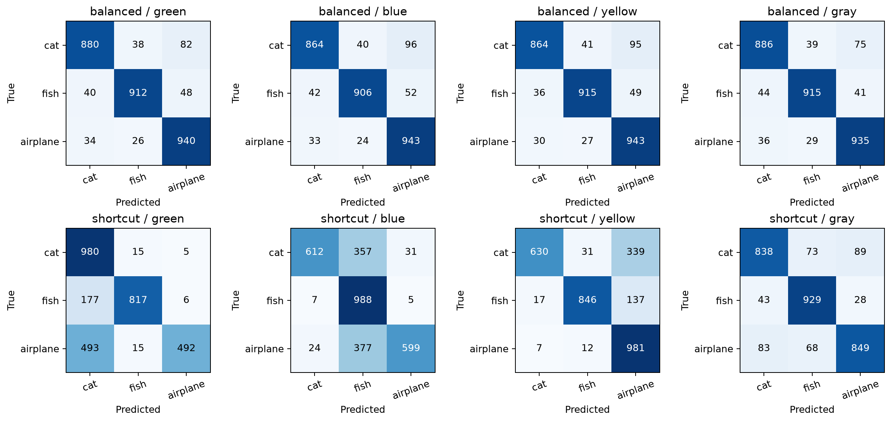
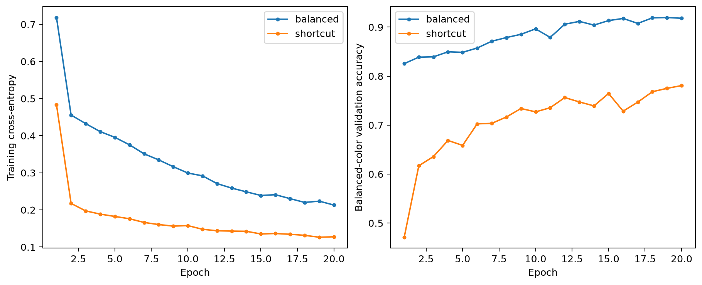

# Phase 1 — phase1-v1

Phase 1 is complete: a frozen full-size dataset, matched trained checkpoints, held-out CPU measurements, and model documentation. Phase 2 has not started.

## Dataset and training

- Source partitions: 8,000 training / 1,000 validation / 1,000 test drawings per class; 30,000 total. Fixed labels: cat=0, fish=1, airplane=2.
- Every pilot source and exact bitmap copy is excluded from all Phase 1 partitions. The new validation and test drawings have not been used in the pilot experiments or reviewed examples.
- Split seed 1590; training seed 1590; color assignment seed 1591. Both models started with identical weights (verified by tensor-content hash).
- Same 26,611-parameter CNN, Adam lr=0.001, batch size 256, 20 epochs. No augmentation, learning-rate schedule, mixed precision, or architecture change.
- Balanced colors: 1/3 each independently of class. Shortcut: cat/green, fish/blue, airplane/yellow with probability .90; each other color .05. Colors are sampled once per source; observed frequencies and per-source assignments are retained.
- Compositing is unchanged from Phase 0: white alpha=intensity/255 over a fixed RGB background, float32 NCHW in [0,1]. Neutral gray is evaluation-only. Partially transparent edge RGB changes when the background changes; alpha and geometry do not.
- Select the first epoch achieving the highest validation accuracy averaged over all three training colors. The test set is used only after both runs finish.
- Actual training devices: balanced=mps, shortcut=mps. Checkpoint tensors are stored on CPU; final evaluation runs on CPU.
- Python, NumPy, PyTorch, and MPS seeds are set and deterministic algorithms requested. This is one seed per regime. Bitwise training equality across devices, operating systems, or PyTorch versions is not promised; CPU inference repeatability is checked separately. See [PyTorch reproducibility guidance](https://docs.pytorch.org/docs/2.14/notes/randomness.html).

## Measured held-out results

All 3,000 test sources are evaluated on green, blue, yellow, and gray: 12,000 inputs per model. Confidence intervals resample source drawings and retain all colors and both model versions together (1,000 percentile bootstrap replicates). They quantify test-sample uncertainty, not training-seed uncertainty.

| Measure (95% CI) | Balanced | Shortcut |
| --- | ---: | ---: |
| Training-like expected accuracy | 90.74% [89.71, 91.73] | 95.13% [94.62, 95.57] |
| Balanced-color accuracy | 90.74% [89.71, 91.73] | 77.17% [76.07, 78.21] |
| Class-correlated mapping accuracy | 90.97% [89.90, 92.00] | 98.30% [97.80, 98.73] |
| Swapped mapping 1 accuracy | 90.63% [89.53, 91.67] | 65.00% [63.30, 66.73] |
| Swapped mapping 2 accuracy | 90.63% [89.60, 91.63] | 68.20% [66.43, 69.90] |
| Green accuracy | 91.07% [90.00, 92.03] | 76.30% [74.83, 77.80] |
| Blue accuracy | 90.43% [89.37, 91.50] | 73.30% [71.67, 74.90] |
| Yellow accuracy | 90.73% [89.70, 91.70] | 81.90% [80.47, 83.27] |
| Neutral-gray accuracy | 91.20% [90.17, 92.20] | 87.20% [85.93, 88.43] |
| Sources with any label flip across 3 colors | 2.70% [2.10, 3.27] | 40.97% [39.10, 42.73] |

Shortcut minus balanced flip rate: 38.27 percentage points; paired 95% CI [36.43, 40.00].

Training-like accuracy is an exact expectation over the three color-specific outputs using each regime’s probabilities. Swapped mappings rotate the class-correlated colors by one or two positions. Background flip rate means at least one label changes across the three training colors; gray is excluded from this rate.






## Phase 1 gate checks

- Source files match recorded SHA-256 values; all 30,000 selected source IDs and bitmap hashes are unique. Excluded pilot manifest SHA-256: `28ee7fea8434de116c4dd4820ad2ae55ee7a98f5935f5ce777c4f809aeba735c`.
- Foreground geometry checked on all 3,000 test sources across four colors. Alpha is exactly unchanged; maximum blend-formula residual 1.19e-07.
- Both models load through `weights_only=True` with CPU mapping, match their manifest and tensor-content hashes, and run in `eval()` mode. Repeated inference produced exactly equal logits for every held-out source/color input. All logits are finite.
- Both model histories are complete. Checkpoint file hashes match their logs; class order, palette, initial weight hash, dependency-lock hash, and source-code hashes are recorded.

## Checkpoints and files

Manifest SHA-256: `de573795c4dbeedff947e25fd33db228e8ddc2020cacc38f82ca3723eb64f159`.

- `checkpoints/phase1-v1/balanced.pt`: selected epoch 19; balanced validation accuracy 0.9196; 8.7s training on mps.
  Checkpoint SHA-256: `bdee90c13b557e085b004abddba7241afd84408389d581efc54c26c47df5e131`; tensor-content SHA-256: `3c47a7624cc4e824b5b98b153f76804da2cf8fcb8cec5f9cc4c300cbfae84d5d`.
  Observed class × color counts (cat/fish/airplane × green/blue/yellow): `[[2720, 2655, 2625], [2611, 2692, 2697], [2549, 2667, 2784]]`.
- `checkpoints/phase1-v1/shortcut.pt`: selected epoch 20; balanced validation accuracy 0.7807; 8.0s training on mps.
  Checkpoint SHA-256: `32b2dcce6f718557123188b30f5e1d1a6c3c9cb5c08fb0f3a895789c5f149124`; tensor-content SHA-256: `1f3612bdb7a458379799b1d19fcf882551c34fc8f5393ea40dd77eebba527bfa`.
  Observed class × color counts (cat/fish/airplane × green/blue/yellow): `[[7195, 394, 411], [403, 7204, 393], [419, 386, 7195]]`.

- `results/phase1/evaluation-table.csv`: condition accuracy with confidence intervals.
- `results/phase1/predictions.csv` and `background-swaps.csv`: full inference and signed paired intervention rows, with source IDs and checkpoint hashes.
- `results/phase1/paired-*.npz`: complete logits, labels, and source IDs for independent recalculation.
- `results/phase1/training-*.json`: full histories, observed counts, config, environment, code and dependency hashes.
- `results/phase1/training-backgrounds.csv`: replay-verified color assignments for every source/model pair.
- `checkpoints/phase1-v1/registry.json`: compact model/input contract and artifact hashes.
- [Dataset card](data-card.md), [balanced model card](model-cards/phase1-v1-balanced.md), [shortcut model card](model-cards/phase1-v1-shortcut.md).

## Reproduce or reevaluate

```sh
uv sync --locked --extra dev
uv run --locked python -m ml.data_loader --config configs/phase1.json
# Checkpoints are included: this evaluates them on CPU without retraining.
uv run --locked python -m ml.evaluate --config configs/phase1.json
# To deliberately replace the recorded checkpoints with a new training run:
uv run --locked python -m ml.train --config configs/phase1.json --device mps --overwrite
uv run --locked python -m ml.evaluate --config configs/phase1.json
uv run --locked pytest -q
```

The configured `auto` device prefers MPS and uses CPU if MPS is unavailable. Explicit `--device mps` fails if MPS is unavailable, preventing silent CPU fallback. A sandbox can hide the accelerator even when it is available on the host. [PyTorch MPS documentation](https://docs.pytorch.org/docs/2.14/notes/mps.html).

Existing training runs are protected unless `--overwrite` is passed. For a different scientific experiment, copy the config and choose new versioned artifact paths. Offline replay requires the three source arrays, whose checksums are enforced.

## Interpretation and limits

- These are measured results from one pair of models. The balanced regime describes the color distribution, not universal fairness or absence of bias. The shortcut regime creates a potentially useful cue; reliance is measured from actual responses.
- Categories, small image size, exact-duplicate filtering, and available bitmap metadata limit generalization. Contributor identities and near-duplicate relationships are unknown. Gray is outside training support.
- Probabilities are uncalibrated. Background-swap effects are within-model input interventions and do not identify a unique internal semantic mechanism.
- No human learning benefit is claimed. Full saliency fidelity and activation-influence studies remain Phase 5 work; this phase validates the dataset and checkpoints.

**Student takeaway:** Training examples influence which clues a model uses. We kept drawings fixed and changed their backgrounds to measure how much each model’s answers depend on color. A high accuracy score alone does not establish that a model will stay reliable when those clues change.

**Gate: Phase 1 complete. Stop for review before Phase 2.**
