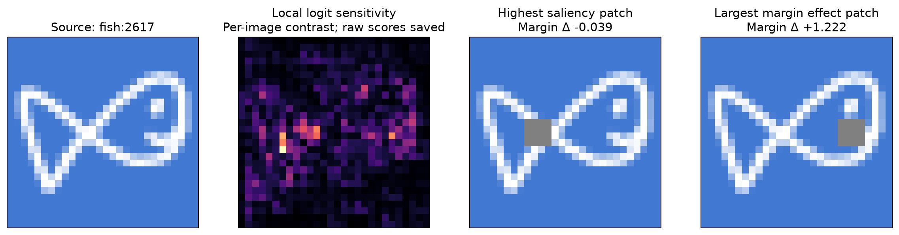
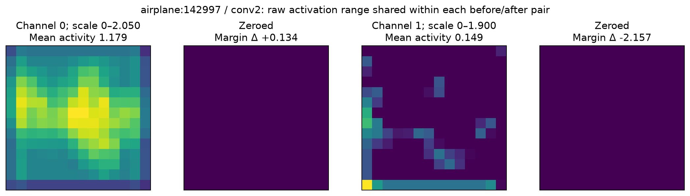
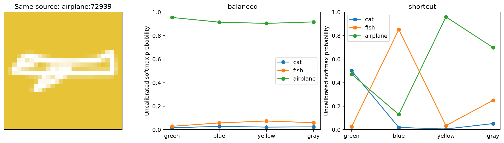

# Phase 2 — Interpretability engine and challenge demonstrations

Phase 2 provides a stateless CPU interpretability engine and validated FastAPI endpoints. This report runs the same engine used by the API against real Phase 1 checkpoints. No new training or frontend work was performed.

## Example selection and scientific boundaries

The demo catalog contains the first eight **training sources per class** from the frozen Phase 1 manifest (24 total). These familiar examples are used for illustration, not independent performance evaluation. Validation and test sources are untouched. The three examples below are curated using declared criteria after scanning this catalog; all scanned rows are saved, including small and null effects. Do not generalize their selected effects to the full dataset.

Activation is observed activity. Saliency is local sensitivity of a selected class logit to input changes. Occlusion, background replacement, and channel zeroing are interventions with measured model effects. An intervention does not prove a unique internal semantic mechanism.

## Challenge 1 — Find the Evidence

**Student question:** Does the brightest saliency region necessarily cause the largest prediction change when covered?

Source `fish:2617`; balanced model; target `fish`. The 28×28 image is divided into 49 nonoverlapping 4×4 patches. Attribution is the sum of absolute RGB gradients of the selected class logit, summed within each patch. Each patch is independently replaced with fixed neutral gray RGB (128,128,128), and the model is rerun from baseline.

Selection rule: Among the 24 catalog sources with correct balanced baseline prediction, maximize influence rank of the highest-saliency patch; first manifest source breaks ties. Curated illustration, not a held-out finding.

| Patch | Coordinates (x,y) | Saliency sum | Rank by saliency | Margin change | Rank by absolute margin effect |
| --- | --- | ---: | ---: | ---: | ---: |
| Highest saliency | (8,12) | 6.6464 | 1 | -0.0388 | 44 |
| Largest margin effect | (20,12) | 4.3445 | 2 | +1.2219 | 1 |

The most salient patch ranks **44 of 49** by absolute margin change. The largest-effect patch ranks **2 of 49** by saliency. Ranks use competition ranking for equal scores. Margin means the target-class score minus the largest competing score; negative change moves the decision away from the target.



**Observe → hypothesize → intervene → reflect:** Inspect the saliency map, record which patch you predict will matter most, cover it, then compare with the independently tested alternatives. A bright gradient measures sensitivity to a tiny local change; covering an entire patch is a larger change, can alter competing scores, and can create an unusual input. Agreement or disagreement must be measured.

**Learning objective:** Distinguish attribution from the effect of an input intervention, and state the replacement policy when interpreting the result.

## Challenge 2 — Inside the Hidden Layers

**Student question:** Is the most active channel always the most influential for this prediction?

Source `airplane:142997`; balanced model; target `airplane`; layer `conv2`. We measure mean post-ReLU activity, then zero each entire channel independently **after ReLU and before pooling**, recomputing all downstream layers.

Selection rule: Among all 24 catalog sources × both convolutional layers with correct baseline predictions, maximize influence rank of the most active channel; first source/layer breaks ties. All channels are ablated independently from baseline.

| Channel selection | Index | Mean activation | Activity rank | Margin change | Rank by absolute margin effect |
| --- | ---: | ---: | ---: | ---: | ---: |
| Highest activity | 0 | 1.1794 | 1 | +0.1341 | 13 |
| Largest margin effect | 1 | 0.1488 | 14 | -2.1566 | 1 |



**Observe → hypothesize → intervene → reflect:** Choose a channel based on its activity, predict the direction of the score change, and zero it. Compare the measured effect with other channels. Explain why downstream weights and interactions can make a less active channel influential. Strong activity alone does not justify calling a channel an “ear detector.”

**Learning objective:** Separate a channel’s response magnitude from its measured influence on a chosen class decision. A positive margin change after removing a channel is possible; influence has a direction.

## Challenge 3 — The Shortcut Trap

**Student question:** Which model changes its answer more when the drawing stays the same but the background changes?

**Balanced model:** Color was independently assigned, with each of the three training colors having probability 1/3 for every class. This describes the color distribution, not universal fairness.

**Shortcut model:** Cat/green, fish/blue, and airplane/yellow occurred with probability .90 in training, with probability .05 for each other color. This creates a potentially useful accidental clue; the experiment measures whether it affects predictions.

Source `airplane:72939`; target `airplane`. The original drawing, stroke alpha, and geometry stay fixed across colors.

Selection rule: Among catalog sources correctly classified by both models on the class-correlated background, maximize shortcut minus balanced true-class probability range across the three training colors; first source breaks ties. Gray is shown separately.

| Model | Background | Predicted class | Target probability | Target margin | Probability change from baseline (points) |
| --- | --- | --- | ---: | ---: | ---: |
| balanced | green | airplane | 95.44% | 3.4942 | +5.03 |
| balanced | blue | airplane | 91.46% | 2.7678 | +1.05 |
| balanced | yellow | airplane | 90.41% | 2.5044 | +0.00 |
| balanced | gray | airplane | 91.67% | 2.7342 | +1.26 |
| shortcut | green | cat | 47.22% | -0.0609 | -48.72 |
| shortcut | blue | fish | 12.95% | -1.8837 | -82.99 |
| shortcut | yellow | airplane | 95.93% | 3.3177 | +0.00 |
| shortcut | gray | airplane | 69.83% | 1.0281 | -26.11 |



Across the three training colors, true-class probability ranges are **5.03 points** for the balanced model and **82.99 points** for the shortcut model. Gray is outside training support and is displayed separately.

**Observe → hypothesize → intervene → reflect:** Start with the model identities hidden as A/B, record which one you expect to depend more on color, switch backgrounds, and compare the results. Reveal the training regimes afterward. Keeping the drawing fixed helps isolate the tested background intervention; it does not show that every shortcut-model prediction relies equally on color.

**Learning objective:** Recognize how a model can use correlations in its training examples and test reliance through a controlled comparison.

## Actual before/after outputs

All selected experiments retain raw logits, uncalibrated softmax probabilities, target margins, signed changes, replay requests, source/checkpoint/manifest hashes, and operation metadata in `results/phase2/selected-examples.json`. The following compact table makes the selected patch and channel effects directly inspectable.

| Operation | Prediction before → after | Target probability before → after | Target margin before → after |
| --- | --- | --- | --- |
| Highest-saliency patch | fish → fish | 89.76% → 91.41% | 2.7390 → 2.7002 |
| Largest-effect patch | fish → fish | 89.76% → 96.89% | 2.7390 → 3.9609 |
| Highest-activity channel | airplane → airplane | 98.63% → 98.37% | 4.3755 → 4.5097 |
| Largest-effect channel | airplane → airplane | 98.63% → 90.07% | 4.3755 → 2.2189 |

A probability and a margin can move in opposite directions because they summarize three class scores differently: softmax uses every score, while the margin compares the target only with its strongest competitor. Saliency here differentiates the target logit; the occlusion comparison also includes the competitor through the margin. These measurements answer related but different questions. A rank mismatch in a curated example is not evidence that all saliency maps are unreliable.

## Engineering verification and replay

- 48 independent reset/replay checks passed with exactly equal baseline logits. Shared model tensor hashes are unchanged after all scans.
- Post-ReLU ablation location, unchanged other channels at injection, gradients, input mask geometry, no cross-request contamination, invalid requests, body/frequency limits, and readiness failures are covered by automated tests.
- API model/sample loading verifies checkpoint, tensor-content, parent-manifest, source-bitmap, and input-contract hashes; requests cannot provide code, model files, arbitrary URLs, or raw images.
- Saliency and activations retain raw numeric values; figure contrast scaling is labeled. Fixed-gray occlusion and source-stroke erasure are distinct operations.

```sh
uv sync --locked --extra dev
uv run --locked uvicorn backend.main:app --host 127.0.0.1 --port 8000
# In another terminal:
uv run --locked python -m experiments.phase2_demo
uv run --locked pytest -q
```

The small source bundle and model checkpoints are included, so the API and report run offline without the bulk dataset files. To reconstruct the bundle from verified full source arrays, run `uv run --locked python -m backend.catalog`.

See [API usage and replay semantics](phase2-api.md). No cloud resources, accounts, database, frontend, or interactive challenge flow has been created.

## Student learning and poster takeaway

**A useful question is: “What changes the model’s decision?”** A heatmap shows local sensitivity. A bright internal map shows activity. Covering pixels, switching a background, or turning off a channel lets us measure an effect. These are different kinds of evidence.

Students should practice making a prediction **before** the intervention, comparing before/after scores, and revising the explanation when the measurement disagrees. The examples supply teaching material for that process; they do not measure whether students learned it.

**Poster takeaway:** FeatureDive makes model explanations testable. Students can compare what appears important with what measurably changes a prediction, and investigate how an accidental background clue influences a model.

**Limitations:** These are curated training examples from one pair of checkpoints. They are not population estimates, a complete semantic circuit analysis, or evidence of educational effectiveness. Input masking can create unusual patterns; results depend on the selected class, mask policy, layer, and channel. Formal held-out research evaluation remains Phase 5; evaluating student learning would require a separate user study.

**Gate: Phase 2 complete. Stop for review before Phase 3.**
