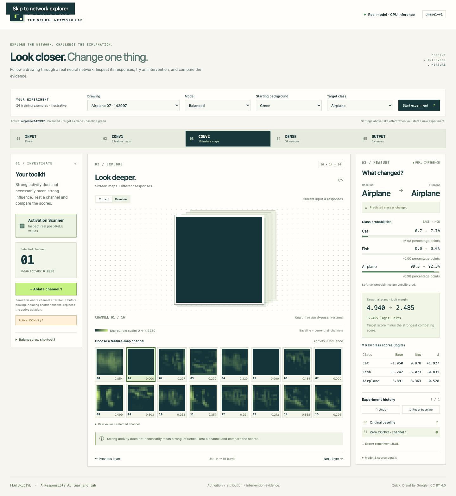

# Phase 3 — Local network explorer

Phase 3 implements a React + TypeScript browser interface connected to the
existing CPU interpretability API. It uses real saved Phase 1 checkpoints and
registered demonstration samples. Guided challenges remain Phase 4 work.

## Run the lab

Install the locked Python environment and frontend dependencies:

```sh
uv sync --locked --extra dev
npm --prefix frontend ci
```

Start the API from the repository root:

```sh
uv run --locked uvicorn backend.main:app --host 127.0.0.1 --port 8000
```

In another terminal, start the frontend:

```sh
npm --prefix frontend run dev
```

Open **http://127.0.0.1:5173/**. Vite forwards `/api/*` to the local CPU API on
port 8000, so there is no cross-origin setup and no public hosting. Serving needs
only the included model checkpoints and compact demo source bundle; the bulk
Quick, Draw! files and MPS are unnecessary for browser inference.

For a local preview of the optimized build, run
`npm --prefix frontend run build`, then `npm --prefix frontend run preview` and
open http://127.0.0.1:4173/. The same API process must be running. Deployment,
Docker packaging, and Cloud Run integration remain Phase 6 work.

## Interaction and state

The interface follows five 2D stops: **Input → Conv1 → Conv2 → Dense → Output**.
Layer buttons, Previous/Next, and left/right arrow keys navigate the network.
Stacked planes, a light perspective treatment, and short CSS transitions suggest
depth without a 3D engine. Reduced-motion preferences disable animation.

The central canvas scales original pixel grids without smoothing. Input displays
28×28 RGB, Conv1 shows eight 28×28 activation maps, Conv2 shows sixteen 14×14
maps, and Dense shows 32 actual post-ReLU values. A selected convolutional map
can be enlarged and its rounded raw values inspected. Activation displays share
a labeled zero-to-maximum scale across all channels and both baseline/current
states. Brightness is a display mapping, not an influence score.

The toolkit changes by layer:

- **Input:** Saliency Scope, drawing erasure, fixed-gray full-region occlusion,
  and background switching. Saliency overlays use real selected-class logit
  gradients, absolute RGB sum, and adjustable client-side opacity. Per-map
  contrast scaling is labeled.
- **Input selections:** single pixel, fixed 4×4 patch, or inclusive drag rectangle.
  Exact coordinates can be entered. Keyboard users can focus the interactive
  canvas, move with arrows, and apply with Enter; Shift + arrows expands a
  rectangle. Fixed patches are kept in bounds. Erasure changes only remaining
  foreground; occlusion replaces the complete selected region with RGB
  (128,128,128).
- **Conv1/Conv2:** channel thumbnails, mean activity, and an Ablation Wand button
  that zeros one entire post-ReLU channel through the actual API. Choosing a
  different ablation preserves input interventions and replaces the prior active
  channel operation. Null effects are displayed honestly.
- **Dense/Output:** observational values, probabilities, and raw class scores;
  no dense ablation or semantic detector labels are invented.

A new drawing/model/starting-background/target selection is a **draft** until
**Start experiment** is pressed. That action explicitly creates a new baseline
and clears its history. Tool changes, channel selection, and layer navigation
never change the baseline. The active experiment remains labeled even while
new settings are drafted.

The comparison panel shows baseline and current labels, three probabilities,
percentage-point changes, logits, signed logit changes, and the target margin.
Margin is the target logit minus the strongest competitor; probabilities remain
uncalibrated. A class that does not flip can still show a meaningful score change.

Each successful intervention adds a replayable history entry. Undo/reset or
clicking a saved entry restores its previously measured snapshot exactly.
Applying a new intervention after undo branches history. Failed requests leave
the last valid snapshot intact. Mutations are serialized, and stale activation
or saliency responses are canceled/ignored using experiment IDs and layer keys.
Small bounded view caches reduce repeated inference requests. Model provenance
and a JSON experiment/history export support inspection and replay.

## Verification

The completed checks are:

- TypeScript checking and optimized Vite production build.
- **7 Vitest tests** for baseline preservation, channel replacement, operation
  limits, history branching, scaled pixel mapping, and region bounds.
- **6 Playwright browser tests** against the live CPU API, including the required
  selection → Conv2 → channel → ablation → measured scores → exact reset flow.
- Browser checks also cover actual saliency and pixel coordinates, erasure,
  background changes, undo, explicit new baselines, dense/output views,
  keyboard navigation, experiment download, failed-request recovery, startup
  retry, and a 390-pixel mobile layout without horizontal overflow.
- **60 existing Python tests** pass. Saved checkpoints and prior scientific
  results are preserved.

Browser checks run with an isolated installed Google Chrome test profile. They
compare displayed values with actual API responses, not invented predictions.
Only explicit failure-path tests intercept requests to simulate unavailable
services; acceptance and model computations use real inference.

```sh
npm --prefix frontend run build
npm --prefix frontend test
npm --prefix frontend run test:e2e
uv run --locked pytest -q
```

Playwright starts the local servers if necessary (or reuses the two development
servers). It uses an installed Google Chrome (`channel: chrome`); CI without
Chrome should install a supported Playwright browser and select it in
`frontend/playwright.config.ts`. Browser launch and localhost binding may require
host permissions when run within a restricted sandbox.

The recorded gate example uses `airplane:142997`, the balanced checkpoint, a
green baseline, and Conv2 channel 1. Its target margin changes from **4.940** to
**2.485** (−2.455 logit units), while the predicted label remains airplane. The
reset restores all three original logits exactly. The acceptance test saves both
actual API responses in `results/phase3/gate-experiment.json`; those saved
records also replay exactly through the Python engine.

Artifacts: [browser test results](../results/phase3/browser-tests.json),
[Conv2 ablation screenshot](../results/phase3/conv2-ablation.png), and
[mobile input screenshot](../results/phase3/mobile-input.png).



## Limits and next review

The catalog contains 24 illustrative **training** drawings, clearly labeled;
no arbitrary uploads, accounts, user database, or learning outcomes are claimed.
History is held in browser memory until a new experiment or reload; export JSON
to retain it. CPU API limits still apply and 429 responses explain when to retry.
Desktop is the primary layout; smaller screens stack the panels. A formal
accessibility audit and user study have not been conducted.

**Gate: Phase 3 complete. Review the explorer before Phase 4 guided challenges.**
