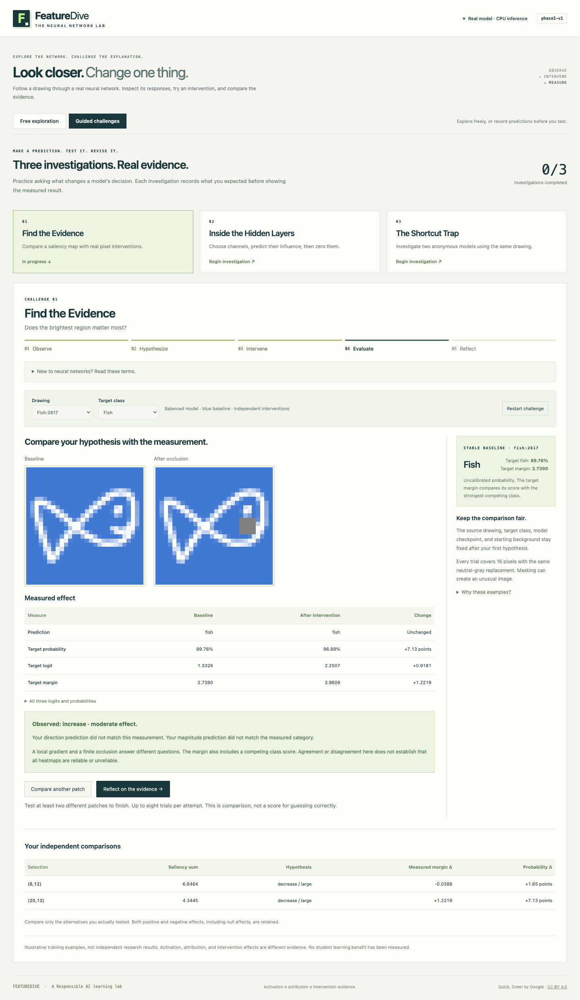
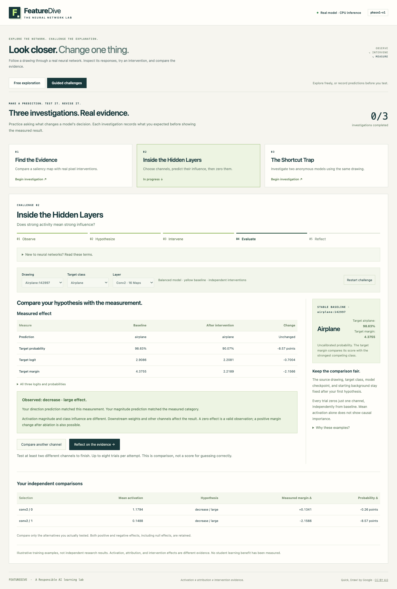
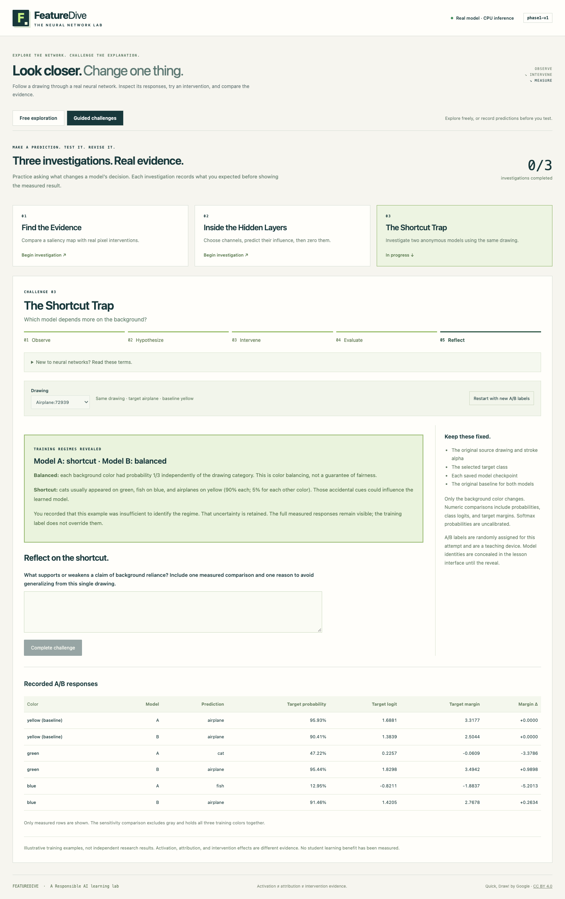

# Phase 4 — Guided investigations

Phase 4 adds three complete challenges to the local browser app. Choose
**Guided challenges** beside **Free exploration**. Each challenge follows
**Observe → Hypothesize → Intervene → Evaluate → Reflect**, uses the saved
`phase1-v1` checkpoints through the real CPU API, and keeps the hypothesis
separate from later measurements. No new training is needed; the checkpoints
retain their Phase 1 MPS training provenance.

The [measured demo appendix](../results/phase4/demo-results.md) is generated
from browser-exported records. These are curated **training** examples selected
in the [Phase 2 teaching scans](phase2-interpretability.md), not held-out research
results. Acceptance-test hypotheses and reflections are explicitly automated
examples. No student study or learning gain is claimed.

## Start the lesson

From the repository root, start the API:

```sh
uv sync --locked --extra dev
uv run --locked uvicorn backend.main:app --host 127.0.0.1 --port 8000
```

In another terminal:

```sh
npm --prefix frontend ci
npm --prefix frontend run dev
```

Open **http://127.0.0.1:5173/** and select **Guided challenges**. The visitor
needs only a browser. Each lesson includes a glossary, prompts, a five-step
tracker, numeric comparisons, and a reflection. A correct guess is not required
to complete it. Completion means making the required comparisons and writing
a reflection; text-length checks do not assess the quality of that reflection.

## Teacher demonstration path

Ask students to predict before running each experiment. Have them cite a
measured number and explain a limit of the evidence afterward. They may choose
another catalog drawing before committing the first hypothesis; the application
does not assume a particular result on other examples.

### 1. Find the Evidence

1. Open **Find the Evidence**; keep `fish:2617`, target fish, blue background.
2. Examine Saliency Scope. Select patch **8,12**. Coordinates are zero-based
   pixels from the left and top; each patch is 4 × 4 pixels.
3. Choose a predicted direction and magnitude, explain why, and click
   **Record hypothesis**. The result has not been requested yet.
4. Click **Run controlled occlusion**. Read the actual before/after numbers.
5. Click **Compare another patch** and repeat for patch **20,12**.
6. Click **Reflect on the evidence**, explain the comparison, complete the
   challenge, and optionally download the record.

In the recorded run, patch (8,12) had saliency sum **6.6464** but margin change
**−0.0388**, classified as little change. Patch (20,12) had lower saliency sum
**4.3445** and margin change **+1.2219**. Both retained the fish prediction.
The latter occlusion increased the target margin; the interface preserves
that result even when the hypothesis predicted a decrease.

This lesson uses **controlled occlusion**: all 16 selected RGB pixels become
fixed gray `(128,128,128)`, including background pixels. It is distinct from
stroke-only Pixel Eraser in free exploration. Equal mask sizes and replacements
make these two patch effects comparable. Saliency is the sum of absolute RGB
gradients of the selected class logit, displayed with contrast scaled per image.
The patch selection value is the sum of those raw saliency values. A local
gradient and a finite occlusion need not agree, and a margin also involves the
strongest competing score. This comparison does not measure the reliability
of all heatmaps.



### 2. Inside the Hidden Layers

1. Open **Inside the Hidden Layers**; keep `airplane:142997`, target airplane,
   yellow background. Conv1 has 8 channels; Conv2 has 16. Choose **Conv2**.
2. Inspect the maps, choose **channel 0**, predict its effect, record the
   hypothesis, then click **Run channel ablation**.
3. Compare **channel 1** with a new recorded hypothesis and another ablation.
4. Reflect using the measured changes and complete the challenge.

Channel 0's mean activity was **1.1794** and its margin change after ablation
was **+0.1341**. Channel 1's mean activity was only **0.1488**, but its margin
change was **−2.1566**. Channel 0 had a smaller absolute effect despite its
stronger average activity. Maps share a raw scale within the chosen layer;
channel indices start at zero.

Each trial zeros one complete post-ReLU channel before pooling, independently
from baseline. ReLU is the stage that replaces negative responses with zero.
Downstream weights and the remaining channels affect the answer. The result
measures this channel's influence in this model on this drawing; it does not
prove the channel has a unique human-readable meaning. The acceptance record
also tests already-silent channel 5: its ablation leaves the logits unchanged,
and the feedback retains this genuine null effect. Note also that channel
0's target margin increased while its target probability fell by **0.26 points**:
these numbers describe different comparisons, so they need not move together.



### 3. The Shortcut Trap

1. Open **The Shortcut Trap**; keep `airplane:72939`, target airplane, original
   yellow background. The identical drawing appears for anonymous **A/B** models.
2. Predict which model's airplane probability will vary more across colors,
   explain why, and click **Record background hypothesis**.
3. Test **green** and **blue**. Yellow is already measured as the baseline.
   Gray is optional and excluded from the three-color summary.
4. Click **Evaluate background evidence**. Compare probability ranges, margin
   ranges, and class flips. Record which model you think had shortcut training
   and state measured evidence; **I cannot tell from this example** is allowed.
5. Click **Record identification & reveal**, then reflect and complete.

A/B assignments are randomized for each attempt; do not memorize an alias.
In the recorded demonstration, the balanced model kept the airplane prediction
on all three colors, with a target-probability range of **5.03 points**. The
shortcut model predicted airplane on yellow, cat on green, and fish on blue;
its airplane-probability range was **82.99 points**. The difference supports
background reliance for this particular example. The training regime is revealed
from the registered checkpoint identity, independently of the measured comparison.

**Balanced** means each of green, blue, and yellow had probability 1/3,
independently of drawing category during training. This removes the designed
color/category association; it does not guarantee fairness or perfect
background invariance.

**Shortcut** means cats usually appeared on green, fish on blue, and airplanes
on yellow: 90% for the associated color and 5% for each alternative. Background
color thus offered an accidental predictive clue that could compete with shape.

The models share their architecture and source/version. Each swap starts from
the original baseline and preserves stroke alpha, source identity, and each
checkpoint. A pair is displayed only if both responses succeed. A/B conceals
identities in the lesson interface; it is a teaching device, not a secure blind
experiment against someone inspecting API traffic or browser tools.



## Feedback and records

Direction/magnitude feedback comes from the **measured target-margin change**,
not the default sample ID or a model of what the student should discover:

| Category | Explicit teaching threshold |
| --- | --- |
| Little change | Absolute margin change ≤ 0.1 |
| Increase / decrease | Signed change outside that tolerance |
| Small | Absolute change < 0.5 |
| Moderate | Absolute change ≥ 0.5 and < 2.0 |
| Large | Absolute change ≥ 2.0 |
| Similar background sensitivity | Probability ranges differ by ≤ 1 percentage point |

These are teaching categories, not statistical significance tests. Background
sensitivity is the maximum minus minimum target probability across green, blue,
and yellow, expressed in percentage points. Negative, positive, null, and
hypothesis-disagreeing results are retained. Softmax outputs are uncalibrated.

The first two challenges require **two different measured selections** before
reflection; already tested selections are disabled. Up to eight independent
trials are allowed. Baseline settings lock after the first recorded hypothesis.
Restart explicitly clears the attempt. Inference failures keep the recorded
hypothesis and offer a retry without adding invented measurements.

Progress and text stay in browser memory across mode/challenge switches.
Reloading clears them. Hypotheses and reflections are not sent to the API or
stored in a database. **Download challenge record** saves the completed attempt
as local JSON containing the original hypotheses, timestamps, selections,
exact requests, checkpoint/source hashes, full measured outputs, feedback,
identification/reveal mapping where relevant, and reflection. The hub retains
the most recent completed record for each challenge even if a new attempt begins.

## Reproduce and verify

```sh
npm --prefix frontend run build
npm --prefix frontend test
npm --prefix frontend run test:e2e
uv run --locked python -m pytest -q
uv run --locked python -m experiments.phase4_report
```

The browser suite starts local API/Vite servers when needed and uses installed
Google Chrome in an isolated test profile. Successful scores always come from
real inference. Only explicit failure paths substitute error responses.
Outputs now go to `results/phase4/`, preserving the Phase 3 evidence.
The report script checks exported checkpoint/version/source-partition metadata
against the registry and summarizes the measured records without running new
inference. Rerun browser acceptance first to refresh the measurements.

Recorded validation: **60 Python tests, 14 frontend unit tests, and 10 browser
tests passed**, including all six explorer regressions. Challenge tests verify
pre-measurement hypothesis ordering, unchanged independent baselines, both
hidden-layer views, measured feedback, reveal gating, retry/state retention,
JSON export, keyboard patch selection, and 390-pixel layouts for all lessons.
Desktop/mobile screenshots were inspected, and the running lesson was also
checked in native Chrome. This is implementation acceptance; testing with a
newcomer remains necessary to substantiate ease of use or educational benefit.

Implementation lives in `frontend/src/challenges/`; the typed client, API,
scientific engine, and saved model artifacts remain shared with free exploration.
No Phase 5 aggregate research evaluation or Phase 6 deployment was performed.

## Student / poster-board takeaway

**Predict. Change one thing. Measure. Rethink.**

A bright heatmap spot or a strongly responding channel can look important.
In these examples, the larger-looking signal did not always have the larger
effect when we changed it. Testing gave us evidence that looking alone could
not provide.

The **balanced model** saw background colors independently of drawing type.
The **shortcut model** usually saw a particular color with each type, giving
it an easy accidental clue. For the same airplane drawing, changing only the
background changed the shortcut model's answer from airplane to cat or fish;
the balanced model kept saying airplane.

These examples teach us to check a model's explanation with a controlled test,
keep unexpected results, and avoid concluding too much from one drawing.
They demonstrate the lesson; they do not prove that students learned more.
